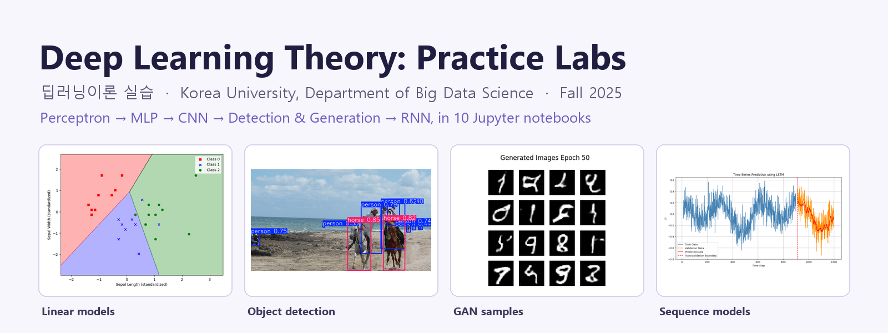
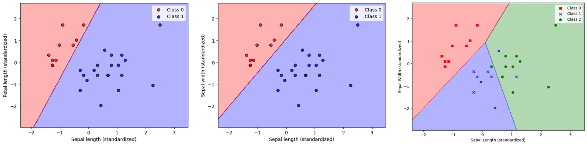
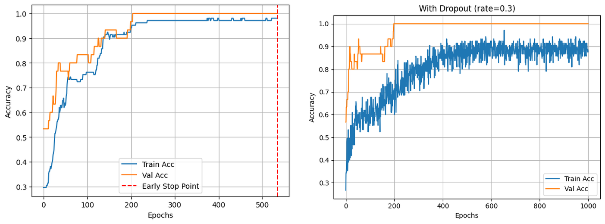
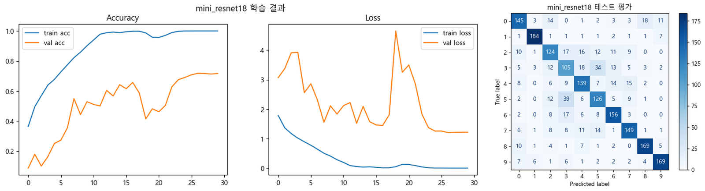
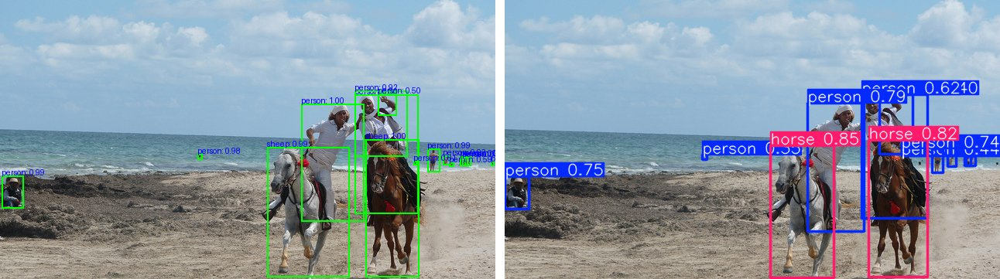
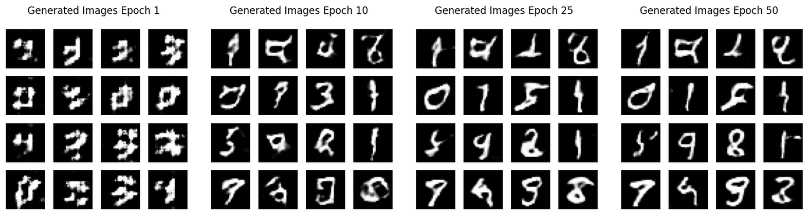
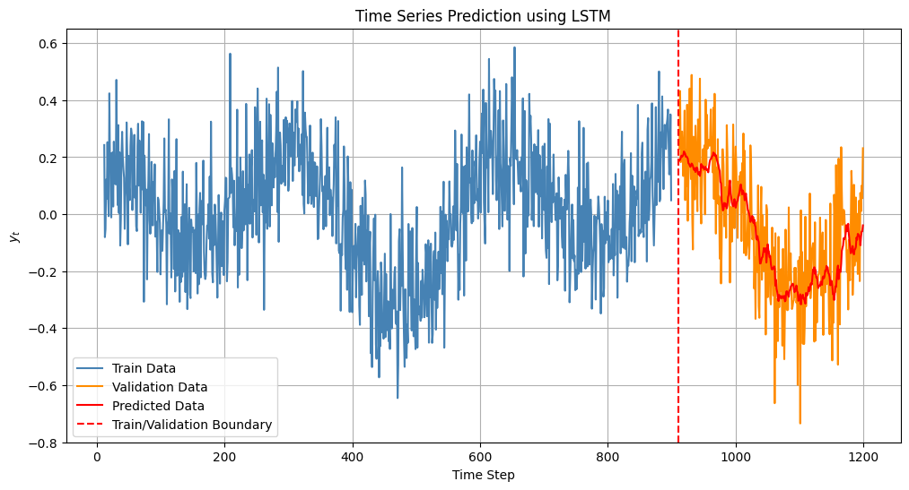

<p align="center">
  
</p>

# Deep Learning Theory: Practice Labs (딥러닝이론 실습)

## About

These are the hands-on lab notebooks I wrote and taught as the teaching assistant for **Deep Learning Theory (딥러닝이론)** in the Department of Big Data Science at **Korea University**, Fall 2025.

The lectures covered the theory. The labs turned each chapter into code students could run, change and break: from a single perceptron on the Iris data to CNNs on CIFAR-10, object detection, GANs, LSTMs and an image-captioning model.

- 8 weekly labs, 10 notebooks, about 700 cells.
- Every notebook is saved **with its outputs**, so you can read the results on GitHub without running anything.
- Notebook text and code comments are in **Korean**, as they were taught.
- TensorFlow/Keras for most labs; PyTorch, torchvision and Ultralytics for the detection and segmentation lab.

## Labs

| Lab | Notebook | Topics |
| :-- | :-- | :-- |
| 1 | [`pandas_numpy_matplotlib_basics`](lab01_python_data_basics/pandas_numpy_matplotlib_basics.ipynb) | Series and DataFrame, CSV input/output, NumPy arrays, basic Matplotlib plots |
| 2 | [`ch02_perceptron_regression_gradient_descent`](lab02_linear_models/ch02_perceptron_regression_gradient_descent.ipynb) | Perceptron, Adaline, logistic and softmax regression on Iris, linear regression on Auto MPG, batch / stochastic / mini-batch gradient descent |
| 3 | [`ch03_multilayer_perceptron`](lab03_neural_network_training/ch03_multilayer_perceptron.ipynb) | A first multilayer network in Keras |
| 3 | [`ch04_training_techniques`](lab03_neural_network_training/ch04_training_techniques.ipynb) | Sigmoid vs. ReLU, weight initialization, SGD vs. Adam, early stopping, dropout, batch normalization |
| 4 | [`ch04_grid_search_mnist`](lab04_cnn_basics/ch04_grid_search_mnist.ipynb) | Hyperparameter search with `GridSearchCV` + SciKeras on MNIST |
| 4 | [`ch05_fcnn_cnn_lenet5_mnist`](lab04_cnn_basics/ch05_fcnn_cnn_lenet5_mnist.ipynb) | Fully connected network vs. CNN vs. LeNet-5 on MNIST |
| 5 | [`ch06_cnn_architectures_cifar10`](lab05_cnn_architectures/ch06_cnn_architectures_cifar10.ipynb) | Mini AlexNet, ZFNet, VGG16, GoogLeNet, ResNet-18 and VGG16 transfer learning on CIFAR-10 |
| 6 | [`ch06_detection_segmentation_style_transfer`](lab06_vision_applications/ch06_detection_segmentation_style_transfer.ipynb) | Faster R-CNN, YOLOv5 / YOLO11, Mask R-CNN, YOLOv8-seg, style transfer with Stable Diffusion XL img2img |
| 7 | [`ch07_pca_autoencoder_factor_analysis_gan`](lab07_unsupervised_generative/ch07_pca_autoencoder_factor_analysis_gan.ipynb) | PCA, autoencoder, factor analysis and a DCGAN, all on MNIST |
| 8 | [`ch08_rnn_lstm_gru_image_captioning`](lab08_recurrent_networks/ch08_rnn_lstm_gru_image_captioning.ipynb) | SimpleRNN, LSTM, GRU, deep and bidirectional RNNs, many-to-many, IMDB sentiment (many-to-one), Flickr8k image captioning (one-to-many) |

## Results from the notebooks

All numbers and figures below come from the saved notebook outputs.

| Lab | Task | Result |
| :-- | :-- | :-- |
| 2 | Iris, 2 features | Adaline 0.93, logistic regression 1.00, softmax regression 0.90 accuracy |
| 4 | MNIST grid search (8 settings, 3-fold CV) | Best: Adam, 32 neurons, dropout 0.1 → 0.948 test accuracy |
| 4 | MNIST | Fully connected 0.981, CNN 0.990, LeNet-5 0.983 test accuracy |
| 5 | CIFAR-10 subset (8,000 train / 2,000 test, 30 epochs) | AlexNet 0.609, ZFNet 0.598, VGG16 0.659, GoogLeNet 0.619, ResNet-18 **0.733** |
| 8 | IMDB sentiment, LSTM | 0.857 test accuracy |

**Lab 2: decision boundaries** (perceptron, logistic regression, softmax regression)



**Lab 3: early stopping and dropout**



**Lab 5: mini ResNet-18 on CIFAR-10**



**Lab 6: Faster R-CNN (left) and YOLO11 (right) on the same COCO image**



**Lab 6: Stable Diffusion XL img2img, "a painting in the style of Van Gogh"**


**Lab 7: GAN samples after epoch 1, 10, 25 and 50**



**Lab 8: LSTM time-series forecast**



## Project structure

```
Deep-Learning-Theory-Practice/
├── assets/                          # figures used in this README
├── lab01_python_data_basics/
│   └── data/                        # example2.csv, example3.csv (written and read by the notebook)
├── lab02_linear_models/
├── lab03_neural_network_training/
├── lab04_cnn_basics/
├── lab05_cnn_architectures/
│   └── mini_vgg16_vs_mini_googlenet.png
├── lab06_vision_applications/
│   ├── images/                      # COCO 2017 sample images used by the notebook
│   └── styled_vangogh.png           # saved SDXL output
├── lab07_unsupervised_generative/
│   └── gan_samples/                 # 4 of the 50 per-epoch GAN snapshots
├── lab08_recurrent_networks/
│   ├── extract_features.py          # VGG16 feature extraction for Flickr8k
│   └── DATA.md                      # how to get the Flickr8k data
├── requirements.txt
└── README.md
```

Each notebook uses paths relative to its own folder, so start Jupyter in the repository root and open notebooks from there.

## Setup

### Conda (recommended)

```bash
conda create -n deeplearning python=3.10 -y
conda activate deeplearning
pip install -r requirements.txt
python -m ipykernel install --user --name deeplearning --display-name "Python (deeplearning)"
```

Then run `jupyter notebook` and pick the **Python (deeplearning)** kernel.

### Notes per lab

- **Labs 1–5, 7:** datasets (Iris, MNIST, CIFAR-10, IMDB, Auto MPG) download automatically through scikit-learn, Keras or seaborn.
- **Lab 5:** each model trains for 30 epochs on 8,000 images. A GPU helps; on a CPU, lower `epochs` first.
- **Lab 6:** pretrained weights (`yolo11n.pt`, `yolov8n-seg.pt`, YOLOv5 via `torch.hub`, torchvision R-CNNs) download on first use. The Stable Diffusion XL section downloads about 7 GB and is slow without a GPU; it is optional.
- **Lab 8:** the image-captioning part needs the Flickr8k dataset. See [`lab08_recurrent_networks/DATA.md`](lab08_recurrent_networks/DATA.md).

## Credits

- Course: Deep Learning Theory (딥러닝이론), Department of Big Data Science, Korea University, Fall 2025.
- Lab notebooks: written by Alex (Abdurakhmon Dadaboev) as the course teaching assistant.
- Lecture slides are not included in this repository.
- Datasets: Iris, MNIST, CIFAR-10, IMDB, Auto MPG, COCO 2017 sample images, Flickr8k. Each belongs to its original authors.

See also: [Text Mining Fundamentals with Python](https://github.com/AlexL71/Text-Mining-Fundamentals), the lab set I built for the text mining course.
